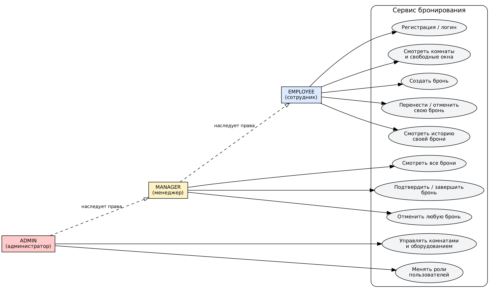
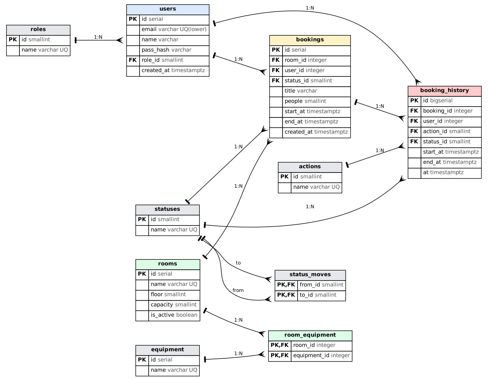
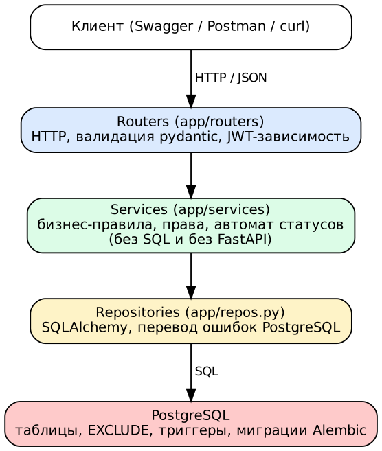
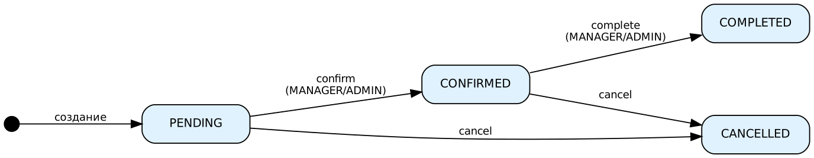

# Проектирование: сервис бронирования переговорных комнат

## 1. Диаграмма вариантов использования

MANAGER наследует права EMPLOYEE, ADMIN — права MANAGER.

## 2. ER-диаграмма

Подробно о нормальных формах — `docs/normalization.md`. DDL — `db/01_tables.sql`,
`db/02_constraints.sql`, `db/03_triggers.sql`, справочники — `db/04_seed.sql`.

| Таблица | Назначение |
| --- | --- |
| roles, statuses, actions | справочники (EMPLOYEE/MANAGER/ADMIN; PENDING/CONFIRMED/COMPLETED/CANCELLED; CREATE/MOVE/CONFIRM/COMPLETE/CANCEL) |
| status_moves | допустимые переходы статусов |
| equipment | оборудование (проектор, ТВ, видеосвязь, маркерная доска) |
| users | пользователи, `pass_hash` — bcrypt |
| rooms | комнаты, `is_active` — мягкое удаление |
| room_equipment | связь «комната — оборудование» (M:N) |
| bookings | брони |
| booking_history | журнал аудита (только добавление) |

## 3. Архитектура

`routers` → `services` → `repos` → PostgreSQL. Сервисы не знают ни про SQL, ни про FastAPI:
репозитории передаются в конструктор, поэтому в модульных тестах подставляются
классы в памяти (`tests/fakes.py`).

Каждое правило защищено дважды: сервис проверяет первым и даёт понятное сообщение,
PostgreSQL — последний рубеж на случай одновременных запросов
(`23P01` → 409, `23514` → 422, `23505` → 409).

## 4. Диаграмма состояний брони

PENDING → CONFIRMED → COMPLETED; PENDING и CONFIRMED → CANCELLED. COMPLETED и CANCELLED
конечные. Переходы лежат в `app/consts.py` (`MOVES`) и в таблице `status_moves`.

## 5. Правила и где они проверяются

| Правило | Сервис | PostgreSQL |
| --- | --- | --- |
| нет пересечений активных броней | `repo.busy` → 409 | `EXCLUDE` (`bookings_no_overlap`) |
| «встык» разрешён | `a1 < b2 and b1 < a2` | полуоткрытый `tstzrange` |
| длительность 15 мин – 4 ч | `rules.check_time` → 422 | `CHECK bookings_len_ck` |
| старт не в прошлом | `rules.check_time` → 422 | — (зависит от текущего времени) |
| рабочее время 09:00–21:00, один день | `rules.check_time` → 422 | — |
| участников ≤ вместимости | `rules.check_people` → 422 | триггер `t_booking_check` |
| комната активна | `_check_all` → 409 | триггер `t_booking_check` |
| допустимые переходы | `rules.can_move` → 409 | триггеры `t_booking_status`, `t_booking_lock` |
| журнал нельзя править | — | триггер `t_history_ro` |

## 6. Права

| Действие | EMPLOYEE | MANAGER | ADMIN |
| --- | :-: | :-: | :-: |
| регистрация, вход, просмотр комнат и свободных окон | + | + | + |
| создать бронь | + | + | + |
| перенести / отменить / посмотреть свою бронь и историю | + | + | + |
| то же для чужой брони | — | + | + |
| список всех броней | — | + | + |
| подтвердить / завершить бронь | — | + | + |
| создать / изменить / деактивировать комнату, оборудование | — | — | + |
| менять роли | — | — | + |

## 7. Эндпоинты (20)

| Метод | Путь | Назначение | Права |
| --- | --- | --- | --- |
| POST | /auth/register | регистрация (роль EMPLOYEE) | все |
| POST | /auth/login | вход, JWT (форма: username = e-mail) | все |
| GET | /users/me | текущий пользователь | вошедший |
| PATCH | /users/{id}/role | смена роли | ADMIN |
| GET | /equipment | список оборудования | вошедший |
| POST | /equipment | добавить оборудование | ADMIN |
| POST | /rooms | создать комнату | ADMIN |
| GET | /rooms | список: `min_capacity`, `floor`, `equipment_id` (несколько), `only_active`, `page`, `size` | вошедший |
| GET | /rooms/{id} | комната | вошедший |
| PUT | /rooms/{id} | изменить | ADMIN |
| DELETE | /rooms/{id} | деактивировать (`is_active=false`) | ADMIN |
| GET | /rooms/{id}/free | свободные окна: `day`, `minutes` | вошедший |
| POST | /bookings | создать | вошедший |
| GET | /bookings | свои; `all=true` — все | вошедший / MANAGER, ADMIN |
| GET | /bookings/{id} | бронь | владелец, MANAGER, ADMIN |
| PUT | /bookings/{id}/move | перенести (и, при желании, в другую комнату) | владелец, MANAGER, ADMIN |
| POST | /bookings/{id}/confirm | подтвердить | MANAGER, ADMIN |
| POST | /bookings/{id}/complete | завершить | MANAGER, ADMIN |
| POST | /bookings/{id}/cancel | отменить | владелец, MANAGER, ADMIN |
| GET | /bookings/{id}/history | журнал изменений | владелец, MANAGER, ADMIN |

Коды ошибок (формат `{"detail": "..."}`): 401 — нет/плохой токен, 403 — нет прав,
404 — не найдено, 409 — конфликт (пересечение, недопустимый переход, комната
неактивна, дубликат), 422 — нарушено правило (время, длительность, вместимость, формат).
